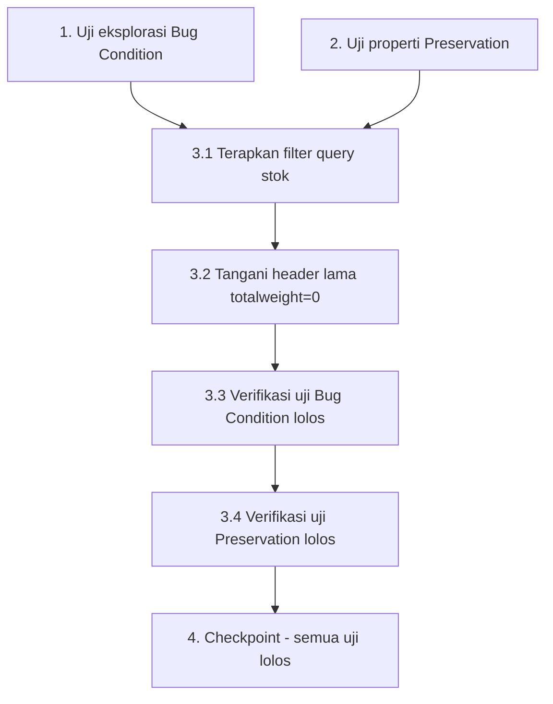

# Implementation Plan

## Overview

Rencana implementasi untuk memperbaiki fatal error "memory exhausted" pada `spk_produksi/addHeader/` yang disebabkan query stok tanpa filter. Mengikuti alur bugfix eksploratif: tulis uji bug condition dan uji pelestarian SEBELUM perbaikan, terapkan perbaikan (filter query + penanganan header lama `totalweight = 0`), lalu verifikasi fix dan pelestarian sesuai Testing Strategy pada design.

## Task Dependency Graph



```json
{
  "waves": [
    { "wave": 1, "tasks": ["1", "2"] },
    { "wave": 2, "tasks": ["3.1"] },
    { "wave": 3, "tasks": ["3.2"] },
    { "wave": 4, "tasks": ["3.3"] },
    { "wave": 5, "tasks": ["3.4"] },
    { "wave": 6, "tasks": ["4"] }
  ]
}
```

## Tasks

- [ ] 1. Tulis uji eksplorasi bug condition (query stok tanpa filter)
  - **Property 1: Bug Condition** - Query Stok Tanpa Filter Menghabiskan Memori pada addHeader
  - **CRITICAL**: Uji ini HARUS GAGAL pada kode yang belum diperbaiki - kegagalan membuktikan bug ada
  - **DO NOT attempt to fix the test or the code when it fails**
  - **NOTE**: Uji ini mengenkode perilaku yang diharapkan - uji akan memvalidasi perbaikan ketika lolos setelah implementasi
  - **GOAL**: Memunculkan counterexample yang membuktikan bug ada
  - **Scoped PBT Approach**: Untuk bug deterministik ini, scope properti ke kasus gagal konkret: pembukaan `spk_produksi/addHeader/` (mode buat-baru, tanpa `id`) saat tabel `stock_material` besar dengan query `SELECT a.* FROM stock_material a` tanpa `WHERE`
  - Dari Bug Condition di design: `isBugCondition(input)` = `input.action == 'addHeader' AND stockQueryHasNoFilter(input) AND fullTableResultSetExceedsMemory(stock_material)`
  - Tulis uji berbasis properti yang menegaskan bahwa query stok yang dibangun `addHeader()` TIDAK mengandung filter `totalweight > 0 AND id_gudang = 1` pada kode belum diperbaiki (memuat seluruh tabel)
  - Opsional/manual: turunkan `memory_limit` sementara lalu buka `spk_produksi/addHeader/` pada tabel besar untuk mengamati fatal error secara langsung; bandingkan dengan `spk_produksi/addHeader_new/` pada kondisi sama (tampil normal → membuktikan filter adalah pembeda)
  - Assertion harus sesuai Expected Behavior Properties dari design: query terfilter memuat hanya subset `totalweight > 0 AND id_gudang = 1` dan halaman termuat tanpa memory error
  - Run uji pada kode BELUM diperbaiki
  - **EXPECTED OUTCOME**: Uji GAGAL (ini benar - membuktikan bug ada)
  - Dokumentasikan counterexample: `SELECT a.* FROM stock_material a` memuat seluruh tabel → fatal error "Allowed memory size of 134217728 bytes exhausted" di `mysqli_result.php`
  - Tandai task selesai ketika uji ditulis, dijalankan, dan kegagalan terdokumentasi
  - _Requirements: 1.1, 1.2_

- [ ] 2. Tulis uji properti pelestarian (SEBELUM mengimplementasikan perbaikan)
  - **Property 2: Preservation** - Rendering Dropdown, Header Tersimpan, Method Lain, dan Opsi Terpilih Header Lama Tidak Berubah
  - **IMPORTANT**: Ikuti metodologi observasi-dulu (observation-first)
  - Amati perilaku pada kode BELUM diperbaiki untuk input non-bug (cases where isBugCondition bernilai false):
    - Observe: dropdown `#id_stock` dirender dengan `id_stock` sebagai value dan `lotno` (uppercase) sebagai label
    - Observe: untuk header SPK yang sudah ada (`addHeader/{id}`), `$header`, `$detail`, dan `$stok` dimuat dengan query terpisah yang tidak berubah
    - Observe: `addHeader_new()` dan `addHeader_view()` berperilaku tertentu dan tidak boleh terdampak
    - Observe (edge): header lama yang `id_stock`-nya kini `totalweight = 0` masih menampilkan opsi lot terpilih
  - Tulis uji berbasis properti yang menangkap pola perilaku teramati dari Preservation Requirements di design:
    - Untuk semua stok lolos filter, opsi dropdown memakai `id_stock`=value dan `lotno`=label
    - Untuk header tersimpan, `$header`/`$detail`/`$stok` tidak berubah
    - Untuk berbagai `id_stock` header, opsi terpilih selalu hadir pada dropdown (termasuk header `totalweight = 0`)
    - Method lain (`addHeader_new()`, `addHeader_view()`) tidak terdampak
  - Property-based testing menghasilkan banyak kasus uji untuk jaminan lebih kuat
  - Run uji pada kode BELUM diperbaiki
  - **EXPECTED OUTCOME**: Uji LOLOS (mengonfirmasi baseline perilaku yang harus dilestarikan). Catatan: uji pelestarian khusus opsi terpilih header `totalweight = 0` mencerminkan baseline sebelum filter; setelah filter, pelestarian ini dijamin oleh penanganan append pada task 3.2
  - Tandai task selesai ketika uji ditulis, dijalankan, dan lolos pada kode belum diperbaiki
  - _Requirements: 3.1, 3.2, 3.3, 3.4_

- [ ] 3. Perbaikan untuk fatal error memory exhausted pada addHeader akibat query stok tanpa filter

  - [ ] 3.1 Terapkan filter query stok terfilter pada addHeader()
    - File: `application/modules/spk_produksi/controllers/Spk_produksi.php`, method `addHeader($id = null, $view = null)`
    - Ubah `$stock = $this->db->query("SELECT a.* FROM stock_material a")->result();` menjadi `$stock = $this->db->query("SELECT a.* FROM stock_material a WHERE a.totalweight > 0 AND id_gudang = 1")->result();`
    - Gunakan format filter yang sama persis dengan `addHeader_new()` untuk konsistensi dan kemudahan perawatan
    - JANGAN ubah query `$header`, `$detail`, dan `$stok` di method ini (pelestarian)
    - JANGAN sentuh method lain (`addHeader_new()`, `addHeader_view()`, `addHeader_view2()`, dsb.)
    - _Bug_Condition: isBugCondition(input) = input.action == 'addHeader' AND stockQueryHasNoFilter(input) AND fullTableResultSetExceedsMemory(stock_material)_
    - _Expected_Behavior: pageLoadsWithoutMemoryError(result) AND stockLoadedIsFilteredSubset(result) AND dropdownIdStockRendered(result)_
    - _Preservation: Preservation Requirements dari design (rendering dropdown, $header/$detail/$stok, method lain)_
    - _Requirements: 2.1, 2.2, 3.1, 3.2, 3.3, 3.4_

  - [ ] 3.2 Tangani header lama yang mereferensikan stok totalweight = 0 (pencegahan regresi)
    - File: `application/modules/spk_produksi/controllers/Spk_produksi.php`, method `addHeader()`
    - Hanya aktif pada mode edit (saat `$header` tidak kosong); ambil `id_stock` dari `$header[0]->id_stock`
    - Jika `id_stock` header tersebut tidak ada dalam himpunan `$stock` hasil query terfilter (karena ter-filter oleh `totalweight > 0`), jalankan query tunggal `SELECT a.* FROM stock_material a WHERE a.id_stock = ?` dan append (gabungkan) hasilnya ke `$stock`
    - Dampak memori minimal (hanya satu baris) dan tidak aktif pada mode buat-baru sehingga tidak mengembalikan masalah memory exhausted
    - Pastikan opsi lot terpilih (`selected`) header lama tetap tampil pada dropdown
    - _Bug_Condition: isBugCondition bernilai false pada mode edit (penanganan ini berada di jalur non-bug)_
    - _Expected_Behavior: selectedOptionForStoredIdStock(addHeader_fixed(input)) IS PRESENT_
    - _Preservation: Nilai id_stock tersimpan pada header lama tetap tampil sebagai opsi terpilih meski totalweight = 0_
    - _Requirements: 3.2, 3.4_

  - [ ] 3.3 Verifikasi uji eksplorasi bug condition sekarang lolos
    - **Property 1: Expected Behavior** - Halaman addHeader Termuat dengan Query Stok Terfilter
    - **IMPORTANT**: Jalankan ulang uji YANG SAMA dari task 1 - JANGAN tulis uji baru
    - Uji dari task 1 mengenkode perilaku yang diharapkan; ketika lolos, mengonfirmasi expected behavior terpenuhi
    - Run uji eksplorasi bug condition dari task 1
    - **EXPECTED OUTCOME**: Uji LOLOS (mengonfirmasi bug telah diperbaiki: query terfilter, halaman termuat tanpa memory error, dropdown terender)
    - _Requirements: 2.1, 2.2_

  - [ ] 3.4 Verifikasi uji pelestarian tetap lolos
    - **Property 2: Preservation** - Rendering Dropdown, Header Tersimpan, Method Lain, dan Opsi Terpilih Header Lama
    - **IMPORTANT**: Jalankan ulang uji YANG SAMA dari task 2 - JANGAN tulis uji baru
    - Run uji properti pelestarian dari task 2
    - **EXPECTED OUTCOME**: Uji LOLOS (mengonfirmasi tidak ada regresi), termasuk opsi lot terpilih header lama `totalweight = 0` tetap hadir berkat penanganan append pada task 3.2
    - Konfirmasi semua uji tetap lolos setelah perbaikan (tanpa regresi)
    - _Requirements: 3.1, 3.2, 3.3, 3.4_

- [ ] 4. Checkpoint - Pastikan semua uji lolos
  - Jalankan uji sesuai Testing Strategy di design (Exploratory Bug Condition, Fix Checking, Preservation Checking, Unit, Property-Based, Integration)
  - Pastikan uji eksplorasi (Property 1) lolos dan uji pelestarian (Property 2) lolos
  - Integration manual: buka `spk_produksi/addHeader/` pada tabel besar (termuat tanpa fatal error, dropdown berisi stok terfilter); buka `spk_produksi/addHeader/{id}` untuk header lama `totalweight = 0` (opsi lot terpilih tetap tampil & ter-select); submit/simpan header dari `addHeader` (alur penyimpanan tidak terpengaruh)
  - Pastikan semua uji lolos; tanyakan ke pengguna bila muncul pertanyaan

## Notes

- Task 1 (Property 1: Bug Condition) sengaja GAGAL pada kode belum diperbaiki untuk membuktikan bug ada. Jangan "memperbaiki" uji saat gagal.
- Task 2 (Property 2: Preservation) harus LOLOS pada kode belum diperbaiki untuk menetapkan baseline perilaku.
- Perbaikan inti hanya satu baris query (task 3.1); task 3.2 mencegah regresi untuk header lama yang mereferensikan stok `totalweight = 0` dan hanya aktif pada mode edit.
- Jangan ubah query `$header`, `$detail`, `$stok` serta method lain (`addHeader_new()`, `addHeader_view()`, dll.) agar pelestarian terjaga.
- Aplikasi berbasis CodeIgniter/PHP; sebagian verifikasi bersifat manual pada level perilaku halaman, dilengkapi pengujian berbasis properti pada logika pemfilteran stok sesuai Testing Strategy di design.
