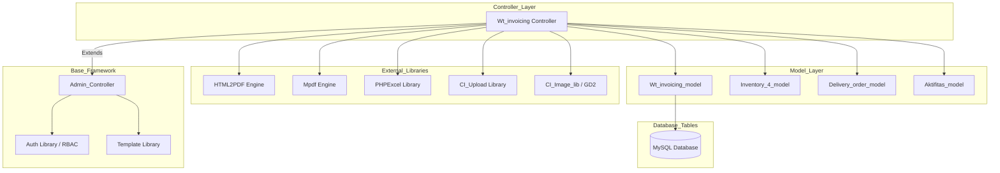
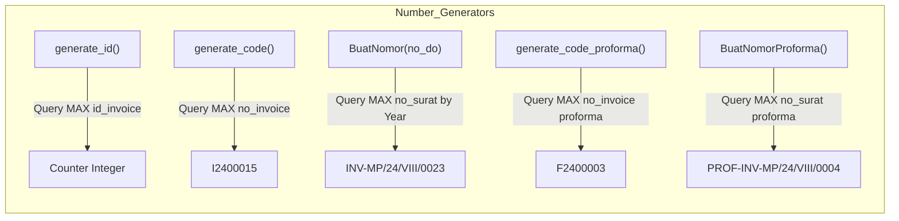
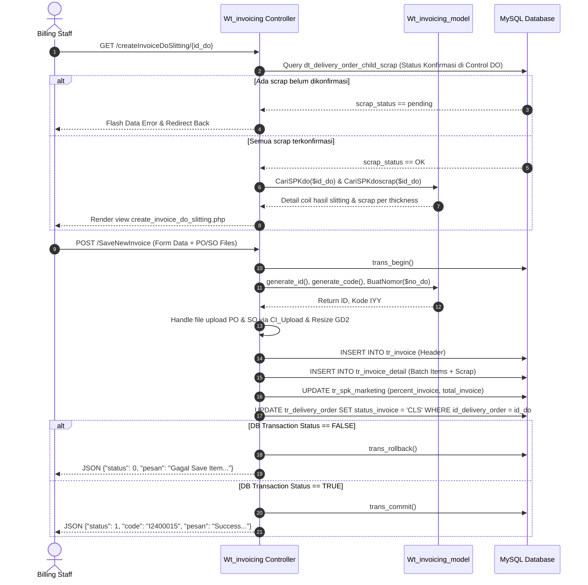
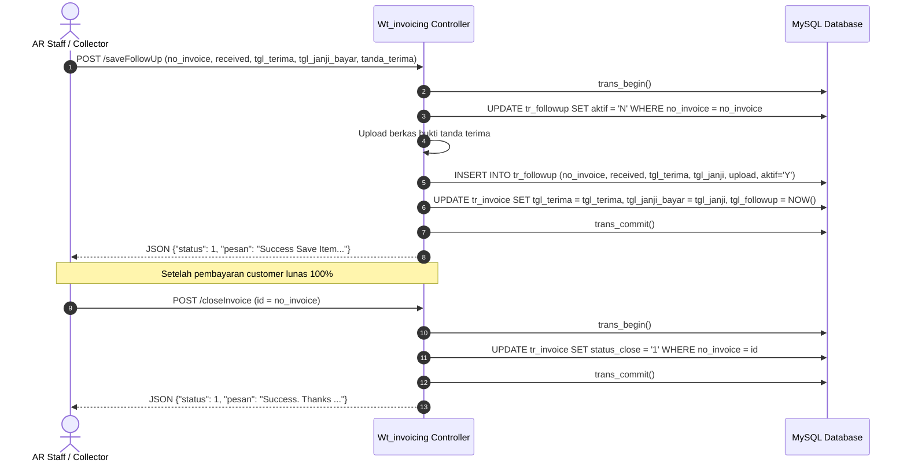
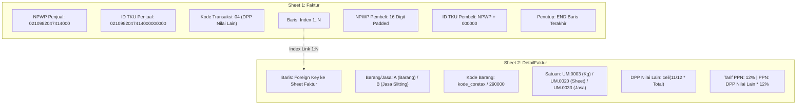
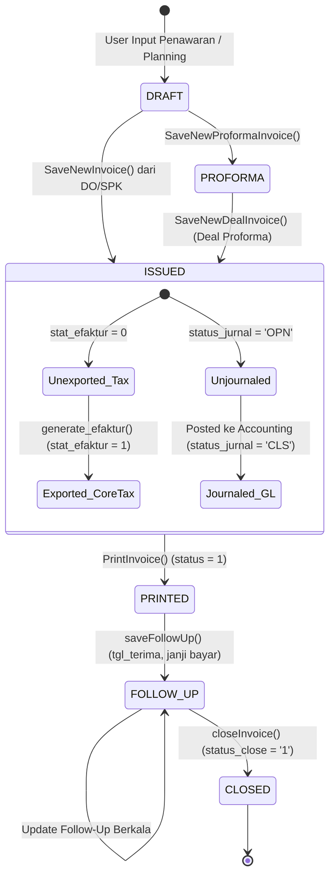

# Dokumen Desain Teknis (Technical Design Document)

# Modul: WT Invoicing (Enterprise Billing, AR Management & CoreTax Integration)

## 1. Arsitektur Modul & Pola Desain

Modul **WT Invoicing** dibangun menggunakan pola arsitektur **HMVC (Hierarchical Model-View-Controller)** pada framework PHP CodeIgniter 3.

```
application/modules/wt_invoicing/
├── controllers/
│   └── Wt_invoicing.php              # Main Controller (3.484 lines)
├── models/
│   └── Wt_invoicing_model.php        # Core Model Layer (1.035 lines)
└── views/
    ├── index_invoice.php             # Halaman utama daftar invoice resmi
    ├── index_proforma_invoice.php    # Daftar proforma invoice
    ├── index_monitoring.php          # Dasbor monitoring piutang (AR Aging)
    ├── index_delivery_order.php      # Daftar Delivery Order siap invoice
    ├── index_spk_marketing.php       # Daftar SPK Marketing siap invoice
    ├── index_efaktur.php             # Antarmuka generate e-Faktur CoreTax
    ├── index_efaktur_list.php        # Riwayat batch ekspor e-Faktur
    ├── index_close.php               # Daftar invoice yang telah closed/lunas
    ├── index_jurnal_piutang.php      # Daftar invoice siap jurnal akuntansi
    ├── index_planning.php            # Daftar planning penagihan termin
    ├── create_invoice.php            # Form pembuatan invoice dari SPK
    ├── create_invoice_do.php         # Form pembuatan invoice dari DO Reguler
    ├── create_invoice_do_slitting.php# Form invoice DO Slitting + Scrap
    ├── create_invoice_proforma.php   # Form penerbitan proforma invoice
    ├── deal_invoice.php              # Form finalisasi invoice dari proforma
    ├── deal_so.php                   # Form deal penawaran ke SO
    ├── preview_invoice.php           # Preview invoice sebelum commit
    ├── createFollowup.php            # Form input follow-up penagihan
    ├── historyfu.php                 # Modal kronologis follow-up invoice
    ├── export_excel_monitoring.php   # Template ekspor Excel monitoring piutang
    ├── PrintInvoice.php              # Template PDF cetak invoice resmi
    ├── PrintPackinglist.php          # Template PDF packing list reguler
    ├── PrintPackinglistSlitting.php  # Template PDF packing list slitting
    ├── PrintProformaInvoice.php      # Template PDF proforma invoice
    ├── PrintHeader2.php              # Template PDF surat jalan reguler
    ├── PrintHeader2Slitting.php      # Template PDF surat jalan slitting
    ├── index_approval.php            # Antarmuka request approval penawaran
    ├── formapproval.php              # Form pengajuan approval penawaran
    ├── formprosesapproval.php        # Form pemrosesan persetujuan penawaran
    ├── index_so.php                  # Antarmuka monitoring status Sales Order
    ├── statusso.php                  # Form update status SO
    ├── statusterkirim.php            # Form update status barang terkirim
    ├── index_loss.php                # Antarmuka monitoring penawaran loss
    ├── formloss.php                  # Form input keterangan loss penawaran
    ├── statusloss.php                # Form update status loss penawaran
    ├── revisipenawaran.php           # Form revisi data penawaran
    ├── editpenawaran.php             # Form edit penawaran harga
    ├── addpenawaran.php              # Form penambahan penawaran harga
    ├── ajukanpenawaran.php           # Form pengajuan penawaran harga
    ├── history.php                   # Riwayat penawaran harga
    └── viewhistory.php               # Detail riwayat penawaran harga
```

### 1.1 Diagram Dependensi Modul



---

## 2. Desain Controller (`Wt_invoicing.php`)

### 2.1 Katalog Endpoint Lengkap

#### A. View Rendering Endpoints (GET / Route Request)

| Method | HTTP | URL Endpoint | Otorisasi | View Template yang Dirender | Deskripsi Fungsional |
| :--- | :---: | :--- | :--- | :--- | :--- |
| `index()` | GET | `/wt_invoicing` | `Invoicing.View` | `index_invoice` | Menampilkan halaman utama daftar invoice resmi. |
| `index_proforma()` | GET | `/wt_invoicing/index_proforma` | `Invoicing.View` | `index_proforma_invoice` | Menampilkan daftar proforma invoice. |
| `spk_marketing()` | GET | `/wt_invoicing/spk_marketing` | `Invoicing.View` | `index_spk_marketing` | Menampilkan daftar SPK Marketing siap invoice. |
| `delivery_order()` | GET | `/wt_invoicing/delivery_order` | `Invoicing.View` | `index_delivery_order` | Menampilkan daftar DO yang belum di-invoice. |
| `index_monitoring()` | GET | `/wt_invoicing/index_monitoring`| `Invoicing.View` | `index_monitoring` | Menampilkan dasbor monitoring piutang (AR aging). |
| `index_close()` | GET | `/wt_invoicing/index_close` | `Invoicing.View` | `index_close` | Menampilkan daftar invoice yang telah ditutup/lunas. |
| `plan_tagih()` | GET | `/wt_invoicing/plan_tagih` | `Invoicing.View` | `index_planning` | Menampilkan jadwal planning penagihan termin. |
| `jurnal_invoicing()` | GET | `/wt_invoicing/jurnal_invoicing`| `Invoicing.View` | `index_jurnal_piutang` | Menampilkan invoice status jurnal `OPN`. |
| `e_faktur()` | GET | `/wt_invoicing/e_faktur` | `Invoicing.View` | `index_efaktur` | Menampilkan antarmuka ekspor e-Faktur CoreTax. |
| `e_faktur_list()` | GET | `/wt_invoicing/e_faktur_list` | `Invoicing.View` | `index_efaktur_list` | Menampilkan riwayat batch ekspor e-Faktur. |
| `createInvoice($id)` | GET | `/wt_invoicing/createInvoice/{id_spk}` | `Invoicing.Add` | `create_invoice` | Form pembuatan invoice langsung dari SPK. |
| `createInvoiceDo($iddo)`| GET | `/wt_invoicing/createInvoiceDo/{id_do}` | `Invoicing.Add` | `create_invoice_do` | Form pembuatan invoice dari Delivery Order reguler. |
| `createInvoiceDoSlitting($iddo)` | GET | `/wt_invoicing/createInvoiceDoSlitting/{id_do}` | `Invoicing.Add` | `create_invoice_do_slitting` | Form invoice DO Slitting (cek scrap control DO). |
| `createProformaInvoice($id)` | GET | `/wt_invoicing/createProformaInvoice/{id_spk}` | `Invoicing.Add` | `create_invoice_proforma`| Form pembuatan proforma invoice dari SPK. |
| `createDealInvoice($id)`| GET | `/wt_invoicing/createDealInvoice/{id_inv}` | `Invoicing.Add` | `deal_invoice` | Form finalisasi deal invoice dari proforma. |
| `previewInvoice($id)` | GET | `/wt_invoicing/previewInvoice/{id_plan}` | `Invoicing.View` | `preview_invoice` | Preview rincian invoice sebelum commit. |
| `FollowUp($id)` | GET | `/wt_invoicing/FollowUp/{no_inv}` | `Invoicing.Manage` | `createFollowup` | Form pencatatan follow-up penagihan. |
| `historyfu($id)` | GET | `/wt_invoicing/historyfu/{no_inv}` | `Invoicing.View` | `historyfu` | Render HTML modal riwayat follow-up invoice. |

#### B. API & Form Mutation Endpoints (POST - JSON Response)

| Method | HTTP | URL Endpoint | Otorisasi | Request Payload | Response Schema & Efek |
| :--- | :---: | :--- | :--- | :--- | :--- |
| `SaveNewInvoice()` | POST | `/wt_invoicing/SaveNewInvoice` | `Invoicing.Add` | Form data header, detail `dt[]`, files `upload_po`, `upload_so` | `{"status": 1, "code": "I2400015", "pesan": "Success..."}` |
| `SaveNewProformaInvoice()` | POST | `/wt_invoicing/SaveNewProformaInvoice` | `Invoicing.Add` | Form data proforma, detail `dt[]`, file uploads | `{"status": 1, "code": "F2400003", "pesan": "Success..."}` |
| `SaveNewDealInvoice()` | POST | `/wt_invoicing/SaveNewDealInvoice` | `Invoicing.Add` | Data deal proforma to invoice | `{"status": 1, "code": "...", "pesan": "Success..."}` |
| `SavePreviewInvoice()` | POST | `/wt_invoicing/SavePreviewInvoice` | `Invoicing.Add` | Data temporary invoice draft | `{"status": 1, "pesan": "Success..."}` |
| `saveFollowUp()` | POST | `/wt_invoicing/saveFollowUp` | `Invoicing.Manage` | `no_invoice`, `received`, `tgl_terima`, `tgl_janji_bayar`, file `tanda_terima` | `{"status": 1, "pesan": "Success Save Item..."}` |
| `closeInvoice()` | POST | `/wt_invoicing/closeInvoice` | `Invoicing.Manage` | `id` (nomor invoice) | `{"status": 1, "pesan": "Success. Thanks ..."}` |
| `generate_efaktur()` | POST | `/wt_invoicing/generate_efaktur` | `Invoicing.Manage` | `id_generate[]` (array nomor surat invoice) | `{"status": "success"}` -> data disalin ke session |

#### C. DataTables Server-Side Processing Endpoints (POST / AJAX)

| Method | HTTP | URL Endpoint | Sumber Data / Model | Output Data |
| :--- | :---: | :--- | :--- | :--- |
| `get_invoicing()` | POST | `/wt_invoicing/get_invoicing` | `Wt_invoicing_model->get_invoicing()` | JSON DataTables daftar invoice terbit. |
| `get_monitoring_invoice()` | POST | `/wt_invoicing/get_monitoring_invoice` | `Wt_invoicing_model->get_monitoring_invoice()` | JSON DataTables monitoring piutang & aging. |
| `get_data_spk_marketing()` | POST | `/wt_invoicing/get_data_spk_marketing` | `Wt_invoicing_model->get_data_spk_marketing()` | JSON DataTables SPK Marketing siap tagih. |
| `get_efaktur()` | POST | `/wt_invoicing/get_efaktur` | `Wt_invoicing_model->get_efaktur()` | JSON DataTables faktur siap ekspor CoreTax. |
| `list_efaktur()` | POST | `/wt_invoicing/list_efaktur` | `Wt_invoicing_model->list_efaktur()` | JSON DataTables riwayat batch log e-Faktur. |
| `get_all_efaktur_id()` | POST | `/wt_invoicing/get_all_efaktur_id` | `Wt_invoicing_model->get_all_efaktur_id()` | Array JSON semua ID invoice untuk *Check All*. |

#### D. Document Export & Printing Endpoints (GET / Binary Stream)

| Method | HTTP | URL Endpoint | Engine | Tipe Konten & Format Output |
| :--- | :---: | :--- | :--- | :--- |
| `PrintInvoice($id)` | GET | `/wt_invoicing/PrintInvoice/{no_inv}` | HTML2PDF | `application/pdf` (Invoice Resmi PT Metalsindo) |
| `PrintPackinglist($id)` | GET | `/wt_invoicing/PrintPackinglist/{no_inv}` | HTML2PDF | `application/pdf` (Packing List Reguler) |
| `PrintPackinglistSlitting($id)`| GET | `/wt_invoicing/PrintPackinglistSlitting/{no_inv}` | HTML2PDF | `application/pdf` (Packing List Slitting + Scrap) |
| `PrintProformaInvoice($id)` | GET | `/wt_invoicing/PrintProformaInvoice/{id_inv}` | HTML2PDF | `application/pdf` (Proforma Invoice) |
| `PrintHeader()` | GET | `/wt_invoicing/PrintHeader/{id_do}` | HTML2PDF | `application/pdf` (Surat Jalan DO Reguler) |
| `PrintHeaderSlitting()` | GET | `/wt_invoicing/PrintHeaderSlitting/{id_do}` | HTML2PDF | `application/pdf` (Surat Jalan DO Slitting) |
| `export_data_mon_inv($t1,$t2)`| GET | `/wt_invoicing/export_data_mon_inv/{t1}/{t2}` | PHPExcel | `application/vnd.ms-excel` (Monitoring Piutang) |
| `export_coretax_excel()` | GET | `/wt_invoicing/export_coretax_excel` | PHPExcel | `application/vnd.openxmlformats` (CoreTax Batch Session) |
| `export_coretax_excel_row()` | GET | `/wt_invoicing/export_coretax_excel_row?getID=x` | PHPExcel | `application/vnd.openxmlformats` (CoreTax by Batch ID) |

---

## 3. Desain Model Layer (`Wt_invoicing_model.php`)

### 3.1 Spesifikasi Generator Penomoran



#### Logika Generator Nomor Surat Resmi (`BuatNomor`):
1. Mengambil tanggal DO rujukan untuk menentukan bulan dan tahun dasar penagihan.
2. Mengonversi 2-digit bulan (`01`-`12`) menjadi angka Romawi (`I`-`XII`).
3. Menjalankan query pencarian nilai counter maksimum pada tahun berjalan:
   ```sql
   SELECT MAX(RIGHT(no_surat, 4)) as max_id
   FROM tr_invoice
   WHERE no_surat LIKE '%/24/%'
   ```
4. Menambahkan counter $+1$ dan memformat dengan 4 digit zero-padding (`sprintf("%04s", $counter)`).
5. Hasil akhir: `INV-MP/24/VIII/0023`.

---

## 4. Sequence Diagrams Alur Transaksi Kritis

### 4.1 Pembuatan Invoice dari Delivery Order Slitting (dengan Scrap Check)



### 4.2 Siklus Follow-Up Piutang & Close Invoice



---

## 5. Mesin Ekspor DJP CoreTax (Tax Engine Specification)

### 5.1 Struktur Spreadsheet Dua Worksheet (`PHPExcel`)



### 5.2 Format Kolom Sheet 1 (`Faktur`)
- **Cell A1:B1 (Merged):** `"NPWP Penjual"` (Bold, Centered)
- **Cell C1:** Explicit String `"0210982047414000"`
- **Header Kolom (Row 3, A3:R3, Bold):**
  `Baris` | `Tanggal Faktur` | `Jenis Faktur` | `Kode Transaksi` | `Keterangan` | `Dokumen Pendukung` | `Period Dok Pendukung` | `Referensi` | `Cap Fasilitas` | `ID TKU Penjual` | `NPWP/NIK Pembeli` | `Jenis ID Pembeli` | `Negara Pembeli` | `Nomor Dokumen Pembeli` | `Nama Pembeli` | `Alamat Pembeli` | `Email Pembeli` | `ID TKU Pembeli`
- **Baris Penutup:** String `"END"` pada Kolom A di baris $N+1$.

### 5.3 Format Kolom Sheet 2 (`DetailFaktur`)
- **Header Kolom (Row 1, A1:N1, Bold):**
  `Baris` | `Barang/Jasa` | `Kode Barang Jasa` | `Nama Barang/Jasa` | `Nama Satuan Ukur` | `Harga Satuan` | `Jumlah Barang Jasa` | `Total Diskon` | `DPP` | `DPP Nilai Lain` | `Tarif PPN` | `PPN` | `Tarif PPnBM` | `PPnBM`
- **Format Angka Kolom H, I, J, L, N:** Number Format `0.00` (*Explicit Double Precision*).

---

## 6. Desain State Machine & Transisi Status Transaksi



---

## 7. Desain Frontend & Mekanisme Kalkulasi Client-Side

### 7.1 Kalkulasi Real-Time JavaScript (Form Invoicing)

Pada view `create_invoice_do.php` dan `create_invoice_do_slitting.php`, interaksi antar field input dikendalikan oleh listener event jQuery:

```javascript
// Kalkulasi PPN & Grand Total Dinamis
function hitungPpn() {
    var totalproduk = parseFloat($('#total').val().replace(/,/g, '')) || 0;
    var persentase  = parseFloat($('#persentase').val().replace(/,/g, '')) || 0;
    var ppn_rate    = parseFloat($('#ppn').val().replace(/,/g, '')) || 0;

    // 1. Hitung Nilai Tagihan Bersih Berdasarkan Persentase Termin
    var tagih = Math.round((totalproduk * persentase) / 100);
    $('#grandtotal').val(number_format(tagih, 2));

    // 2. Hitung DPP Nilai Lain (11/12)
    var dpp = Math.ceil((11 / 12) * tagih);
    $('#dpp').val(number_format(dpp, 2));

    // 3. Hitung PPN 12%
    var totalppn = Math.round((dpp * ppn_rate) / 100);
    $('#totalppn').val(number_format(totalppn, 2));

    // 4. Hitung Nilai Tagih Akhir (Grand Total)
    var grand_total = tagih + totalppn;
    $('#nilai_tagih').val(number_format(grand_total, 2));
}
```

### 7.2 Konfigurasi DataTables Server-Side AJAX

```javascript
$('#table_invoice').DataTable({
    processing: true,
    serverSide: true,
    ajax: {
        url: base_url + 'wt_invoicing/get_invoicing',
        type: 'POST',
        data: function (d) {
            d.custom_filter = $('#filter_status').val();
        }
    },
    order: [[0, 'desc']],
    columnDefs: [
        { targets: [-1], orderable: false, className: 'text-center' }
    ]
});
```

---

## 8. Desain Keamanan, Integritas Data & Penanganan Error

| Layer Keamanan | Mekanisme Implementasi |
| :--- | :--- |
| **Authentication & RBAC** | Pemeriksaan hak akses per method melalui `$this->auth->restrict($this->managePermission)`. Jika gagal, sistem memutus eksekusi dan redirect ke unauthorized page. |
| **Database Transaction ACID** | Seluruh transaksi multi-tabel (`tr_invoice`, `tr_invoice_detail`, `tr_spk_marketing`, `tr_delivery_order`) dilindungi blok `$this->db->trans_begin()`, rollback otomatis jika status `FALSE`. |
| **Pencegahan Timeout & Memory Exhaustion** | Pada method ekspor file besar (`export_coretax_excel`), sistem memanggil `ini_set('memory_limit', '1024M')` dan `set_time_limit(0)` serta membersihkan buffer output `while (ob_get_level()) { ob_end_clean(); }`. |
| **Sanitasi File Upload** | Validasi whitelist ekstensi (`pdf|jpg|png|doc|docx|xls|xlsx`), pembatasan ukuran berkas, dan sanitasi nama file untuk mencegah eksekusi *Remote Code Execution* (RCE). |
