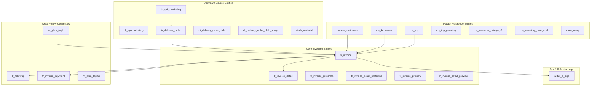
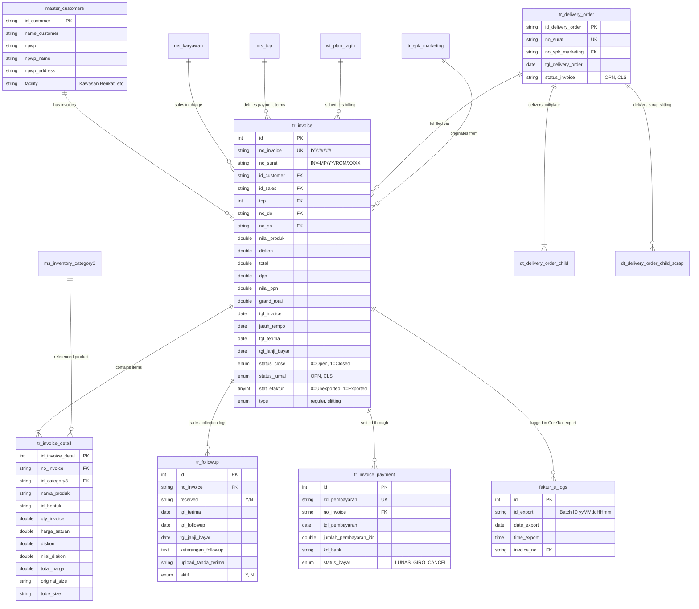

# Entity Relationship Diagram (ERD) & Database Architecture

# Modul: WT Invoicing (Enterprise Billing, AR Management & CoreTax Integration)

## 1. Arsitektur Basis Data & Skema Umum

| Komponen | Spesifikasi Teknis |
| :--- | :--- |
| **Engine Basis Data** | MySQL 5.7 / 8.0 (InnoDB & MyISAM Storage Engines) |
| **Pola Integritas Data** | **Logical Foreign Key Pattern** (Integritas dijaga pada level *Application Logic / Active Record & DB Transactions*) |
| **Karakter Set & Collation** | `utf8` / `utf8_general_ci` |
| **Penanganan Transaksi** | Multi-table ACID Transactions (`trans_begin()`, `trans_commit()`, `trans_rollback()`) |
| **Audit Trail Standard** | `created_by`, `created_on`, `modified_by`, `modified_on`, `printed_by`, `printed_on` |

---

## 2. Inventaris Tabel & Klasifikasi Entitas



---

## 3. Kamus Data Lengkap (Data Dictionary)

### 3.1 Tabel `tr_invoice` (Header Invoice Resmi)

Tabel utama yang menyimpan data header seluruh invoice resmi yang diterbitkan kepada customer.

| Nama Kolom | Tipe Data | Null | Key | Default | Deskripsi Bisnis & Integritas |
| :--- | :--- | :---: | :---: | :--- | :--- |
| `id` | `int(11)` | NO | PRI | *auto_increment* | Primary key internal header invoice. |
| `no_invoice` | `varchar(20)` | YES | MUL | NULL | Kode unik invoice format internal (contoh: `I2400015`). |
| `no_surat` | `varchar(255)` | YES | MUL | NULL | Nomor resmi surat invoice (contoh: `INV-MP/24/VIII/0023`). |
| `no_so` | `varchar(20)` | YES | | NULL | Referensi nomor SO / `id_spkmarketing`. |
| `no_penawaran` | `varchar(20)` | YES | | NULL | Nomor penawaran asal transaksi. |
| `no_proforma_invoice` | `varchar(255)` | YES | | NULL | Nomor proforma invoice jika dikonversi dari proforma. |
| `tgl_invoice` | `date` | YES | | NULL | Tanggal penerbitan invoice resmi. |
| `id_customer` | `varchar(20)` | YES | MUL | NULL | Logical FK ke `master_customers.id_customer`. |
| `pic_customer` | `varchar(255)` | YES | | NULL | Nama PIC customer penerima tagihan. |
| `mata_uang` | `varchar(255)` | YES | | NULL | Mata uang transaksi (default: IDR). |
| `email_customer` | `varchar(255)` | YES | | NULL | Email penagihan customer. |
| `valid_until` | `date` | YES | | NULL | Masa berlaku penawaran/tagihan. |
| `top` | `int(11)` | YES | | NULL | Logical FK ke `ms_top.id_top` (Term of Payment). |
| `keterangan_top` | `varchar(255)` | YES | | NULL | Keterangan rincian termin pembayaran. |
| `order_status` | `varchar(255)` | YES | | NULL | Status order material (`stk` = stock, dll). |
| `id_sales` | `varchar(255)` | YES | | NULL | Logical FK ke `ms_karyawan.id_karyawan`. |
| `nama_sales` | `varchar(255)` | YES | | NULL | Nama sales/marketing (*denormalized*). |
| `pengiriman` | `varchar(100)` | YES | | NULL | Metode/moda pengiriman barang. |
| `alamat` | `varchar(255)` | YES | | NULL | Alamat tujuan pengiriman fisik tagihan/barang. |
| `referensi` | `varchar(255)` | YES | | NULL | Nomor referensi dokumen pendukung customer. |
| `no_faktur` | `varchar(255)` | YES | | NULL | Nomor seri faktur pajak (NSFP) / Faktur DJP. |
| `jatuh_tempo` | `date` | YES | | NULL | Tanggal batas akhir pembayaran (Due Date). |
| `status` | `int(11)` | YES | | `0` | Status cetak dokumen (`0` = Belum Cetak, `1` = Sudah Cetak). |
| `revisi` | `int(11)` | YES | | `0` | Indeks nomor revisi invoice. |
| `keterangan` | `varchar(255)` | YES | | NULL | Catatan tambahan internal invoice. |
| `nilai_produk` | `double(50,2)` | YES | | `0.00` | Akumulasi nilai kotor seluruh item barang/jasa. |
| `diskon` | `double(40,2)` | YES | | `0.00` | Nilai total potongan diskon harga (Rp). |
| `total` | `double(40,2)` | YES | | `0.00` | Nilai total setelah diskon sebelum pajak. |
| `persentase` | `double(50,0)` | YES | | `0` | Persentase penagihan termin (%) dari total SPK. |
| `nilai_invoice` | `double(50,2)` | YES | | `0.00` | Nilai tagihan bersih yang ditagihkan. |
| `dpp` | `double(40,2)` | YES | | `0.00` | Dasar Pengenaan Pajak (DPP Nilai Lain: 11/12 x Total). |
| `ppn` | `double(50,0)` | YES | | `0` | Tarif persentase PPN yang diterapkan (12%). |
| `nilai_ppn` | `double(50,2)` | YES | | `0.00` | Nilai rupiah PPN (12% x DPP). |
| `grand_total` | `double(50,2)` | YES | | `0.00` | Total akhir tagihan ($\text{Total} + \text{Nilai PPN}$). |
| `upload_po` | `varchar(255)` | YES | | NULL | Path direktori berkas PO customer (`./assets/file_po/`). |
| `upload_so` | `varchar(255)` | YES | | NULL | Path direktori berkas SO/DO (`./assets/file_do/`). |
| `id_invoice` | `int(11)` | YES | | NULL | Counter integer id invoice internal. |
| `id_plan_tagih` | `int(11)` | YES | | NULL | Logical FK ke `wt_plan_tagih.id_plan_tagih`. |
| `payment` | `varchar(255)` | YES | | NULL | Metode pembayaran (Cash, Transfer, Giro, dll). |
| `total_bayar` | `double(50,2)` | YES | | `0.00` | Akumulasi total pembayaran yang telah diterima. |
| `total_bayar_idr` | `double(40,2)` | YES | | `0.00` | Akumulasi total bayar dalam mata uang IDR. |
| `sisa_invoice_idr` | `double(40,2)` | YES | | `0.00` | Sisa saldo piutang belum tertagih (IDR). |
| `tgl_terima` | `date` | YES | | NULL | Tanggal invoice fisik diterima oleh customer. |
| `tgl_followup` | `date` | YES | | NULL | Tanggal pelaksanaan follow-up penagihan terakhir. |
| `tgl_janji_bayar` | `date` | YES | | NULL | Tanggal komitmen pembayaran oleh customer. |
| `status_close` | `enum('0','1')` | YES | | `'0'` | Status penutupan tagihan (`0` = Open/Aktif, `1` = Closed/Lunas). |
| `status_jurnal` | `enum('OPN','CLS')` | YES | | `'OPN'` | Status integrasi akuntansi (`OPN` = Belum Jurnal, `CLS` = Terjurnal). |
| `no_do` | `varchar(255)` | YES | | NULL | Nomor surat Delivery Order rujukan. |
| `tgl_do` | `date` | YES | | NULL | Tanggal terbit Delivery Order. |
| `no_po` | `varchar(255)` | YES | | NULL | Nomor Purchase Order dari customer. |
| `tgl_po` | `date` | YES | | NULL | Tanggal Purchase Order dari customer. |
| `id_do` | `varchar(255)` | YES | MUL | NULL | Logical FK ke `tr_delivery_order.id_delivery_order`. |
| `tahun` | `date` | YES | | NULL | Tahun pencatatan transaksi invoice. |
| `type` | `enum('reguler','slitting')` | YES | | `'reguler'` | Klasifikasi tipe transaksi invoice. |
| `stat_efaktur` | `tinyint(1)` | NO | | `0` | Status ekspor CoreTax (`0` = Belum Ekspor, `1` = Sudah Ekspor). |
| `note` | `varchar(255)` | YES | | NULL | Catatan/klausul syarat pembayaran pada invoice. |
| `created_by` | `varchar(35)` | YES | | NULL | ID user pembuat record. |
| `created_on` | `datetime` | YES | | NULL | Waktu pembuatan record. |
| `modified_by` | `varchar(35)` | YES | | NULL | ID user pengubah record. |
| `modified_on` | `text` | YES | | NULL | Waktu perubahan record. |
| `printed_by` | `varchar(35)` | YES | | NULL | ID user yang mencetak invoice fisik/PDF. |
| `printed_on` | `datetime` | YES | | NULL | Waktu cetak invoice fisik/PDF. |
| `delivered_by` | `varchar(35)` | YES | | NULL | ID staf pengirim tagihan. |
| `delivered_on` | `datetime` | YES | | NULL | Waktu pengiriman tagihan ke customer. |
| `approved_by` | `varchar(35)` | YES | | NULL | ID user yang menyetujui invoice. |
| `approved_on` | `datetime` | YES | | NULL | Waktu persetujuan invoice. |
| `revisi_by` | `varchar(35)` | YES | | NULL | ID user pembuat revisi. |
| `revisi_on` | `datetime` | YES | | NULL | Waktu pembuatan revisi. |

---

### 3.2 Tabel `tr_invoice_detail` (Detail Item Invoice)

Menyimpan rincian setiap item material atau jasa yang ditagihkan dalam satu nomor invoice.

| Nama Kolom | Tipe Data | Null | Key | Default | Deskripsi Bisnis & Integritas |
| :--- | :--- | :---: | :---: | :--- | :--- |
| `id_invoice_detail` | `int(11)` | NO | PRI | *auto_increment* | Primary key baris detail invoice. |
| `id_penawaran_detail` | `int(11)` | YES | | NULL | Logical FK ke detail penawaran. |
| `id_so_detail` | `int(11)` | YES | | NULL | Logical FK ke detail sales order. |
| `no_invoice` | `varchar(20)` | YES | MUL | NULL | Logical FK ke `tr_invoice.no_invoice` (Kode IYY#####). |
| `no_so` | `varchar(20)` | YES | | NULL | Nomor SO / SPK Marketing rujukan. |
| `no_penawaran` | `varchar(20)` | YES | | NULL | Nomor surat penawaran harga rujukan. |
| `id_category3` | `varchar(20)` | YES | MUL | NULL | Logical FK ke `ms_inventory_category3.id_category3`. |
| `nama_produk` | `varchar(255)` | YES | | NULL | Nama deskriptif material/jasa (*denormalized*). |
| `id_bentuk` | `varchar(255)` | YES | | NULL | ID bentuk fisik (`B2000001` = Coil, `B2000002` = Sheet, dll). |
| `qty_invoice` | `double(40,2)` | YES | | `0.00` | Kuantitas yang ditagihkan pada invoice ini (Kg/Sheet). |
| `qty` | `double(40,2)` | YES | | `0.00` | Kuantitas pesanan awal pada SPK Marketing. |
| `harga_satuan` | `double(40,2)` | YES | | `0.00` | Harga satuan kesepakatan (*unit price*) per unit. |
| `stok_tersedia` | `double(40,2)` | YES | | `0.00` | Snapshot posisi stok saat invoice dibuat. |
| `potensial_loss` | `double(40,2)` | YES | | `0.00` | Estimasi berat loss / scrap. |
| `diskon` | `double(40,2)` | YES | | `0.00` | Persentase diskon per item (%). |
| `nilai_diskon` | `double(50,2)` | YES | | `0.00` | Nilai nominal rupiah potongan diskon item. |
| `freight_cost` | `double(40,2)` | YES | | NULL | Biaya pengiriman/ongkos angkut per item. |
| `total_harga` | `double(40,2)` | YES | | NULL | Nilai kotor item ($\text{Qty Invoice} \times \text{Harga Satuan}$). |
| `keterangan` | `varchar(225)` | YES | | NULL | Keterangan spesifik baris barang. |
| `revisi` | `int(11)` | YES | | `0` | Nomor indeks revisi baris item. |
| `tgl_delivery` | `date` | YES | | NULL | Tanggal realisasi pengiriman item. |
| `diskon_compare` | `double(40,2)` | YES | | `0.00` | Nilai pembanding diskon. |
| `id_invoice` | `int(11)` | YES | | NULL | Logical FK ke `tr_invoice.id_invoice`. |
| `original_size` | `varchar(255)` | YES | | NULL | Dimensi ukuran bahan baku asal (*Mother Coil size*). |
| `tobe_size` | `varchar(255)` | YES | | NULL | Dimensi ukuran target jadi (*Thickness x Width x Length*). |
| `part_number` | `varchar(255)` | YES | | NULL | Nomor part number spesifik customer. |
| `created_by` | `varchar(35)` | YES | | NULL | ID user pembuat baris detail. |
| `created_on` | `datetime` | YES | | NULL | Timestamp pembuatan baris detail. |
| `modified_by` | `varchar(35)` | YES | | NULL | ID user pengubah baris detail. |
| `modified_on` | `datetime` | YES | | NULL | Timestamp pengubahan baris detail. |

---

### 3.3 Tabel `tr_invoice_proforma` & `tr_invoice_detail_proforma`

Menyimpan dokumen penagihan sementara pra-pengiriman (Proforma Invoice).

- **`tr_invoice_proforma`:** Memiliki struktur identik dengan `tr_invoice` (dengan penyesuaian: nomor kode berawalan `FYY#####`, nomor surat `PROF-INV-MP/...`, tanpa field `stat_efaktur` dan `type`).
- **`tr_invoice_detail_proforma`:** Memiliki struktur identik dengan `tr_invoice_detail` yang merujuk pada `tr_invoice_proforma.no_invoice`.

---

### 3.4 Tabel `tr_followup` (Riwayat & Log Penagihan Piutang)

Mencatat setiap interaksi komunikasi, penerimaan fisik tagihan, dan komitmen pembayaran oleh customer.

| Nama Kolom | Tipe Data | Null | Key | Default | Deskripsi Bisnis & Integritas |
| :--- | :--- | :---: | :---: | :--- | :--- |
| `id` | `int(11)` | NO | PRI | *auto_increment* | Primary key catatan follow-up. |
| `no_invoice` | `varchar(50)` | YES | MUL | NULL | Logical FK ke `tr_invoice.no_invoice`. |
| `received` | `varchar(10)` | YES | | NULL | Status konfirmasi invoice diterima customer (`Y` / `N`). |
| `tgl_terima` | `date` | YES | | NULL | Tanggal tanda terima invoice fisik oleh customer. |
| `tgl_followup` | `date` | YES | | NULL | Tanggal staf AR melakukan kontak follow-up. |
| `tgl_janji_bayar` | `date` | YES | | NULL | Tanggal janji pembayaran hasil follow-up. |
| `keterangan_followup`| `text` | YES | | NULL | Notulensi detail hasil percakapan dengan PIC customer. |
| `upload_tanda_terima`| `varchar(255)` | YES | | NULL | Lokasi file bukti foto/scan tanda terima tagihan. |
| `aktif` | `enum('Y','N')` | YES | | `'Y'` | Flag follow-up aktif (`Y` = status terkini, `N` = riwayat lampau). |
| `created_by` | `varchar(35)` | YES | | NULL | ID user staf penagihan. |
| `created_on` | `datetime` | YES | | NULL | Timestamp pencatatan follow-up. |
| `modified_by` | `varchar(35)` | YES | | NULL | ID user pengubah. |

---

### 3.5 Tabel `faktur_e_logs` (Audit Log Batch Ekspor CoreTax)

Mencatat setiap transaksi ekspor berkas e-Faktur ke standar DJP CoreTax.

| Nama Kolom | Tipe Data | Null | Key | Default | Deskripsi Bisnis & Integritas |
| :--- | :--- | :---: | :---: | :--- | :--- |
| `id` | `int(11)` | NO | PRI | *auto_increment* | Primary key log ekspor e-Faktur. |
| `id_export` | `varchar(50)` | YES | MUL | NULL | ID Batch Ekspor format `yyMMddHHmm` (contoh: `2608221045`). |
| `date_export` | `date` | NO | | NULL | Tanggal pelaksanaan ekspor. |
| `time_export` | `time` | YES | | NULL | Waktu/jam pelaksanaan ekspor. |
| `invoice_no` | `varchar(25)` | NO | MUL | NULL | Logical FK ke `tr_invoice.no_surat` yang diekspor. |

---

### 3.6 Tabel `tr_invoice_payment` (Penerimaan Pembayaran Kas/Bank)

Menyimpan mutasi pembayaran kas/bank yang melunasi piutang invoice.

| Nama Kolom | Tipe Data | Null | Key | Default | Deskripsi Bisnis |
| :--- | :--- | :---: | :---: | :--- | :--- |
| `id` | `int(11)` | NO | PRI | *auto_increment* | Primary key pembayaran. |
| `kd_pembayaran` | `varchar(50)` | NO | UNI | NULL | Kode unik voucher penerimaan pembayaran. |
| `no_invoice` | `varchar(50)` | YES | MUL | NULL | Logical FK ke `tr_invoice.no_invoice`. |
| `jenis_reff` | `varchar(50)` | YES | | NULL | Jenis instrumen (Transfer, Giro, Cek, Tunai). |
| `no_reff` | `varchar(50)` | YES | | NULL | Nomor referensi giro/bukti transfer bank. |
| `tgl_pembayaran` | `date` | YES | | NULL | Tanggal efektif dana masuk. |
| `kurs_bayar` | `double` | YES | | NULL | Nilai kurs valas pada saat transaksi pembayaran. |
| `jumlah_piutang` | `double` | YES | | NULL | Posisi saldo piutang sebelum pembayaran. |
| `jumlah_bank_idr` | `double` | YES | | NULL | Nominal bersih dana yang masuk ke rekening bank (IDR).|
| `jumlah_pembayaran_idr`| `double`| YES | | NULL | Total nilai piutang yang diakui terbayar (IDR). |
| `pembayaran_ke` | `int(11)` | YES | | NULL | Indeks pembayaran ke-n (cicilan/termin). |
| `kd_bank` / `nm_bank` | `varchar` | YES | | NULL | Kode dan nama rekening bank penerima. |
| `biaya_admin_idr` | `decimal(10,2)`| YES | | `0.00` | Potongan biaya administrasi bank. |
| `biaya_pph_idr` | `decimal(10,2)`| YES | | `0.00` | Potongan PPh Pasal 23 / bukti potong pajak. |
| `status_bayar` | `enum` | YES | | NULL | Status: `'LUNAS'`, `'GIRO'`, `'CANCEL'`. |
| `status_jurnal` | `enum('0','1')`| YES | | `'0'` | Status posting jurnal kas masuk (`0`/`1`). |

---

### 3.7 Tabel `wt_plan_tagih` & `wt_plan_tagih2` (Planning Penagihan Termin)

| Nama Kolom | Tipe Data | Null | Key | Default | Deskripsi Bisnis |
| :--- | :--- | :---: | :---: | :--- | :--- |
| `id_plan_tagih` | `int(11)` | NO | PRI | *auto_increment* | Primary key jadwal planning penagihan. |
| `id_top` | `varchar(255)` | YES | | NULL | Logical FK ke `ms_top.id_top`. |
| `id_top_planning` | `varchar(255)` | YES | | NULL | Logical FK ke `ms_top_planning.id_top_planning`. |
| `payment` | `varchar(255)` | YES | | NULL | Keterangan jenis pembayaran (DP, Termin 1, Pelunasan). |
| `keterangan` | `varchar(255)` | YES | | NULL | Rincian klausul termin penagihan. |
| `persentase` | `double(50,0)` | YES | | NULL | Bobot persentase tagihan (contoh: 30%, 50%, 20%). |
| `nilai` | `double(50,2)` | YES | | NULL | Total nilai kontrak SPK Marketing. |
| `nilai_tagih` | `double(50,2)` | YES | | NULL | Nilai rupiah yang ditagihkan pada termin ini. |
| `no_so` | `varchar(255)` | YES | MUL | NULL | Nomor SO / `id_spkmarketing`. |
| `status_invoice` | `enum('0','1')`| YES | | `'0'` | Status pembuatan invoice (`0` = Belum, `1` = Sudah). |
| `nilai_invoice` | `double(50,2)` | YES | | NULL | Realisasi nilai invoice yang diterbitkan. |
| `tgl_create_inv` | `date` | YES | | NULL | Tanggal invoice dibuat dari plan tagih ini. |
| `no_planning` | `varchar(255)` | YES | | NULL | Nomor surat planning delivery. |

---

## 4. Entity Relationship Diagram (Visual Mermaid)



---

## 5. Spesifikasi Database Views

Modul `wt_invoicing` memanfaatkan sejumlah view teroptimasi untuk mempercepat agregasi query DataTables server-side:

### 5.1 View `v_spk_marketing`
- **Tujuan:** Agregasi data SPK Marketing yang siap ditagihkan beserta total nilai nominal deal.
- **Tabel Dasar:** `tr_spk_marketing a` LEFT JOIN `master_customers b` ON `b.id_customer = a.id_customer` LEFT JOIN `dt_spkmarketing c` ON `c.id_spkmarketing = a.id_spkmarketing`.
- **Kolom Kunci:** `id_spkmarketing`, `no_surat`, `tgl_spk_marketing`, `name_customer`, `total_nilai_spk`, `status_approve`.

### 5.2 View `view_detail_delivery_order`
- **Tujuan:** Menampilkan detail item barang fisik hasil pengiriman DO reguler.
- **Tabel Dasar:** `tr_delivery_order a` INNER JOIN `dt_delivery_order_child b` ON `b.id_delivery_order = a.id_delivery_order`.
- **Kolom Kunci:** `id_delivery_order`, `no_spk_marketing`, `id_material`, `total_kirim`, `width`, `length`, `lotno`, `id_stock`.

### 5.3 View `view_detail_delivery_order_scrap`
- **Tujuan:** Mengagregasi scrap hasil slitting per ketebalan (*thickness*) untuk penagihan invoice slitting.
- **Tabel Dasar:** `tr_delivery_order a` INNER JOIN `dt_delivery_order_child_scrap b` ON `b.id_delivery_order = a.id_delivery_order`.
- **Kolom Kunci:** `id_delivery_order`, `id_material`, `thickness`, `total_kirim`, `width`, `kode_gabung`.

### 5.4 View `view_efaktur_invoice`
- **Tujuan:** Agregasi data invoice resmi dan identitas perpajakan customer untuk antarmuka e-Faktur CoreTax.
- **Tabel Dasar:** `tr_invoice a` LEFT JOIN `master_customers b` ON `b.id_customer = a.id_customer` LEFT JOIN subquery agregat `tr_invoice_detail`.
- **Kolom Kunci:** `no_invoice`, `tgl_invoice`, `nama_customer`, `npwp`, `nomor_do`, `term`, `nilai_dpp`, `nilai_ppn`, `nilai_invoice`, `stat_efaktur`.

---

## 6. Matriks Relasi Antar Tabel (Relational Map)

| Entitas Sumber | Kolom FK | Entitas Rujukan | Kolom PK | Kardinalitas | Aturan Integritas Aplikasi |
| :--- | :--- | :--- | :--- | :---: | :--- |
| `tr_invoice` | `id_customer` | `master_customers` | `id_customer` | N : 1 | Customer harus aktif & tidak dihapus (`deleted = '0'`). |
| `tr_invoice` | `id_sales` | `ms_karyawan` | `id_karyawan` | N : 1 | Karyawan aktif terdaftar sebagai marketing. |
| `tr_invoice` | `top` | `ms_top` | `id_top` | N : 1 | Penentuan jangka waktu jatuh tempo otomatis. |
| `tr_invoice` | `id_do` | `tr_delivery_order` | `id_delivery_order`| N : 1 | 1 DO hanya menghasilkan 1 Invoice Resmi (Status DO -> `CLS`). |
| `tr_invoice` | `no_so` | `tr_spk_marketing` | `id_spkmarketing` | N : 1 | Akumulasi `percent_invoice` & `total_invoice` diupdate di SPK. |
| `tr_invoice_detail` | `no_invoice` | `tr_invoice` | `no_invoice` | N : 1 | Detail terhapus/terinput secara atomik bersama header. |
| `tr_invoice_detail` | `id_category3` | `ms_inventory_category3`| `id_category3` | N : 1 | Mengambil deskripsi spesifikasi ukuran baku material. |
| `tr_followup` | `no_invoice` | `tr_invoice` | `no_invoice` | N : 1 | Menyimpan kronologis follow-up; flag `aktif='Y'` hanya 1 record. |
| `tr_invoice_payment`| `no_invoice` | `tr_invoice` | `no_invoice` | N : 1 | Mengurangi nilai `sisa_invoice_idr` secara kumulatif. |
| `faktur_e_logs` | `invoice_no` | `tr_invoice` | `no_surat` | N : 1 | Mengubah flag `stat_efaktur = 1` pada invoice terkait. |

---

## 7. Strategi Indexing & Optimasi Query

Untuk menjamin performa sub-detik pada volume transaksi ratusan ribu record:

```sql
-- 1. Indexing untuk Pencarian & Filter DataTables Invoice
ALTER TABLE `tr_invoice` ADD INDEX `idx_inv_search` (`no_surat`, `id_customer`, `tgl_invoice`, `status_close`);
ALTER TABLE `tr_invoice` ADD INDEX `idx_inv_do` (`id_do`);
ALTER TABLE `tr_invoice` ADD INDEX `idx_inv_so` (`no_so`);
ALTER TABLE `tr_invoice` ADD INDEX `idx_inv_tax` (`stat_efaktur`, `no_surat`);

-- 2. Indexing untuk Agregasi Detail Item
ALTER TABLE `tr_invoice_detail` ADD INDEX `idx_inv_dt_no` (`no_invoice`);
ALTER TABLE `tr_invoice_detail` ADD INDEX `idx_inv_dt_mat` (`id_category3`);

-- 3. Indexing untuk Log CoreTax
ALTER TABLE `faktur_e_logs` ADD INDEX `idx_export_batch` (`id_export`, `date_export`);
ALTER TABLE `faktur_e_logs` ADD INDEX `idx_export_inv` (`invoice_no`);

-- 4. Indexing untuk Follow-Up AR
ALTER TABLE `tr_followup` ADD INDEX `idx_fu_inv_aktif` (`no_invoice`, `aktif`);
```
