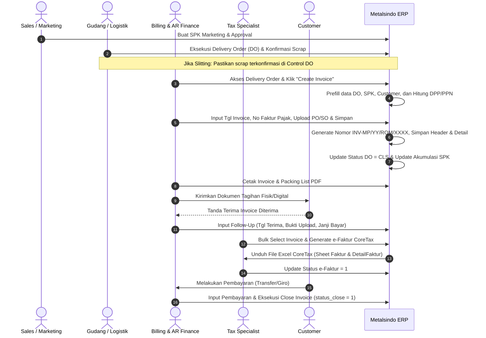
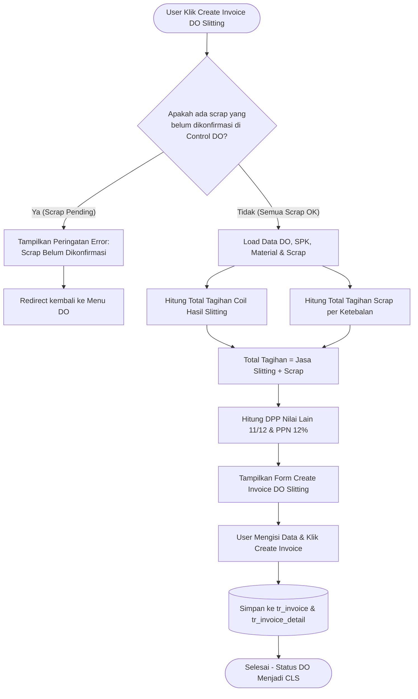
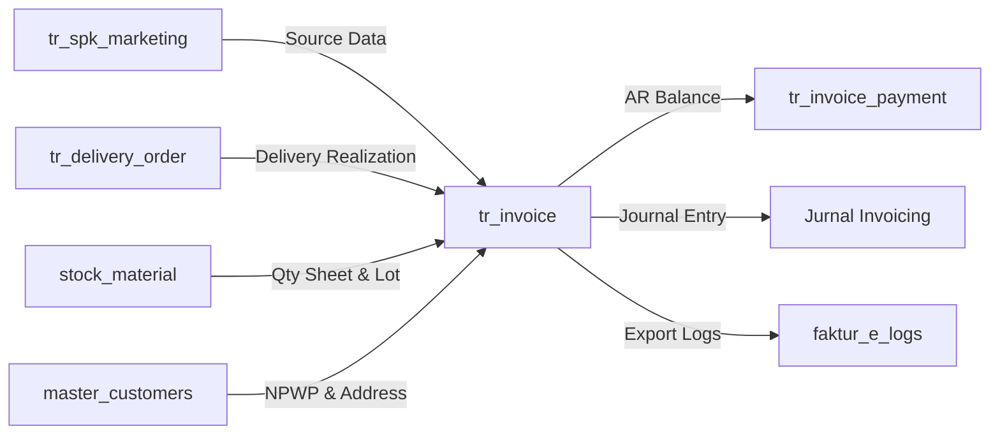

# Product Requirements Document (PRD)

# Modul: WT Invoicing (Enterprise Billing, AR Management & CoreTax Integration)

## 1. Informasi Dokumen & Metadata

| Atribut Dokumen | Rincian Spesifikasi |
| :--- | :--- |
| **Nama Modul** | **WT Invoicing** (*Warehouse & Trading Invoicing System*) |
| **Kode Modul** | `wt_invoicing` |
| **Sistem Utama** | Metalsindo Enterprise Resource Planning (ERP) |
| **Versi Dokumen** | **2.0 (Comprehensive Enterprise Edition)** |
| **Tanggal Terbit** | 22 Agustus 2026 |
| **Status Dokumen** | **Approved / Production Ready** |
| **Penulis / Modeler** | Tim Arsitektur Sistem & Engineering Metalsindo ERP |
| **Target Pengguna** | Billing Officer, AR/Finance Specialist, Sales & Marketing, Tax Specialist, Accounting Manager |
| **Framework & Stack** | CodeIgniter 3 (HMVC Pattern), MySQL 5.7/8.0 (InnoDB/MyISAM), PHP 7.4+, jQuery 3.x, DataTables Server-side, HTML2PDF, PHPExcel |
| **Domain Industri** | Steel & Non-Ferrous Metal Processing (Coil Slitting, Shearing, Sheet Stocking, Material Trading) |

---

## 2. Latar Belakang & Konteks Bisnis

PT Metalsindo bergerak dalam industri manufaktur pengolahan logam dan perdagangan baja/aluminium dengan spesialisasi proses **Shearing** (pemotongan plat/sheet) dan **Slitting** (pemotongan coil menjadi strip berukuran presisi). Proses operasional bisnis dari hulu ke hilir memiliki keterikatan yang ketat:

$$\text{Inquiry / Penawaran} \longrightarrow \text{SPK Marketing / SO} \longrightarrow \text{Planning \& Produksi} \longrightarrow \text{Delivery Order (DO)} \longrightarrow \mathbf{WT\ Invoicing} \longrightarrow \text{AR Monitoring \& Pembayaran}$$

### 2.1 Masalah Bisnis yang Diselesaikan
1. **Kompleksitas Perhitungan Multi-Bentuk & Scrap:**
   - Penjualan material reguler (coil/plat) dihitung berdasarkan berat aktual (Kg), sedangkan material tipe **Sheet** (`id_bentuk = 'B2000002'`) memerlukan perhitungan berbasis lembar (`qty_sheet`) yang tersimpan dalam stock lot.
   - Proses **Jasa Slitting** memisahkan antara billing jasa produk utama dan billing **Scrap** (sisa potong/trimming) yang harus terverifikasi terlebih dahulu di modul Control DO sebelum dapat ditagihkan.
2. **Kepatuhan Pajak DJP CoreTax Terbaru (Regulasi UU HPP):**
   - Implementasi perhitungan **DPP Nilai Lain** ($\lceil \frac{11}{12} \times \text{Total} \rceil$) dan tarif **PPN 12%**.
   - Kebutuhan ekspor data multi-sheet Excel (Sheet *Faktur* & *DetailFaktur*) yang sesuai dengan standar DJP CoreTax (validasi NPWP 16 digit, format TIN, identitas TKU penjual/pembeli, dan klasifikasi kode transaksi `04`).
3. **Penyelarasan Termin Pembayaran (Term of Payment - TOP) & Proforma:**
   - Fleksibilitas pembuatan Proforma Invoice untuk pembayaran uang muka (*Down Payment* / termin bertahap) sebelum invoice resmi diterbitkan.
   - Rekonsiliasi termin pembayaran via `wt_plan_tagih` untuk menghindari tagihan ganda atau selisih persentase penagihan.
4. **Monitoring Piutang (AR Aging) & Riwayat Follow-Up:**
   - Pelacakan umur piutang (*Aging Analysis*) secara *real-time* berbasis tanggal terima invoice oleh customer.
   - Dokumentasi bukti tanda terima fisik (upload file) dan catatan janji bayar (*Promise to Pay Date*) yang terintegrasi.
5. **Konektivitas Akuntansi:**
   - Menghubungkan invoice yang terbit ke modul jurnal piutang (*General Ledger*) melalui status `OPN` (Open) menuju `CLS` (Closed).

---

## 3. Tujuan Modul (Objectives & Key Results)

### 3.1 Tujuan Fungsional
1. **Sentralisasi Pembuatan Tagihan:** Mendukung multi-sumber pembuatan invoice (dari SPK Marketing langsung, DO Reguler, maupun DO Slitting).
2. **Kontrol Validasi Scrap:** Memblokir penagihan DO Slitting jika terdapat lot scrap yang belum dikonfirmasi oleh tim gudang/operasional di *Control DO*.
3. **Automasi Kalkulasi Pajak:** Menghitung DPP Nilai Lain, PPN 12%, diskon, dan grand total secara presisi dengan penanganan khusus fasilitas *Kawasan Berikat* (PPN 0% / Bebas PPN).
4. **Otomatisasi CoreTax Engine:** Menghasilkan file Excel batch impor CoreTax siap upload ke portal DJP tanpa intervensi manual.
5. **Pengawasan Piutang Terintegrasi:** Menyediakan dasbor interaktif monitoring piutang lengkap dengan indikator umur piutang, form follow-up, dan pelunasan (*Close Invoice*).
6. **Penerbitan Dokumen Resmi:** Cetak dokumen berkualitas tinggi dalam format PDF untuk Invoice Resmi, Proforma Invoice, Packing List Reguler, Packing List Slitting, dan Surat Jalan.

### 3.2 Key Performance Indicators (KPI)
- **Zero Miscalculation:** Akurasi 100% pada perhitungan DPP Nilai Lain, PPN, dan scrap slitting.
- **Pajak Compliance:** 0% kegagalan format impor pada skema XML/Excel CoreTax DJP.
- **Efisiensi Waktu Penerbitan Invoice:** Memangkas waktu pembuatan invoice dan packing list dari 15 menit menjadi < 1 menit per transaksi.
- **Transparansi AR Aging:** Pemantauan piutang jatuh tempo terpantau secara harian dengan histori log interaksi penagihan yang transparan.

---

## 4. Stakeholder & Matriks Hak Akses (RBAC)

Modul `wt_invoicing` menerapkan kontrol akses berbasis peran (*Role-Based Access Control*).

| Role Pengguna | Tanggung Jawab Utama | Hak Akses Modul |
| :--- | :--- | :--- |
| **Billing / AR Staff** | Membuat draft invoice, input DO, input no faktur pajak, upload PO/SO, cetak invoice & packing list, follow-up penagihan. | `Invoicing.View`, `Invoicing.Add`, `Invoicing.Manage` |
| **Finance Manager** | Melakukan review penagihan, validasi aging piutang, eksekusi closing invoice, persetujuan penagihan termin. | `Invoicing.View`, `Invoicing.Manage`, `Invoicing.Delete` |
| **Tax Specialist (Pajak)** | Mengelola nomor faktur pajak, bulk generate data e-Faktur, ekspor format Excel CoreTax, audit log faktur pajak. | `Invoicing.View`, `Invoicing.Manage` |
| **Sales & Marketing** | Melihat status penerbitan invoice SPK, mengajukan proforma invoice, monitoring pembayaran customer. | `Invoicing.View`, `Penawaran.View` |
| **Accounting Staff** | Menjurnal invoice yang sudah terbit ke buku besar (GL) dan integrasi akun piutang usaha. | `Invoicing.View`, `Invoicing.Manage` |
| **Super Administrator** | Pengaturan hak akses, audit trail aktivitas, pemeliharaan sistem, dan konfigurasi master data. | `ALL ACCESS` |

### 4.1 Granular Permissions Matrix

| Fitur / Aksi | Permission String | Keterangan |
| :--- | :--- | :--- |
| Melihat Daftar Invoice & Monitoring | `Invoicing.View` | Akses view index invoice, proforma, DO, SPK, monitoring, & e-Faktur |
| Membuat Invoice / Proforma / Follow-Up | `Invoicing.Add` | Akses form pembuatan transaksi baru dan simpan data |
| Cetak Dokumen, Close Invoice, Generate Tax | `Invoicing.Manage` | Akses print PDF, export Excel, generate e-Faktur, close tagihan |
| Menghapus Data Transaksi | `Invoicing.Delete` | Akses pembatalan / penghapusan invoice |

---

## 5. Fitur Utama & Spesifikasi Fungsional

```mermaid
graph TD
    A[Modul WT Invoicing] --> B[1. Core Invoicing]
    A --> C[2. Proforma & Planning]
    A --> D[3. Monitoring & AR Follow-Up]
    A --> E[4. DJP CoreTax Engine]
    A --> F[5. Document & Print Engine]
    A --> G[6. Accounting & Jurnal]
    A --> H[7. Penawaran & SO Bridge]

    B --> B1[Create dari SPK Marketing]
    B --> B2[Create dari DO Reguler]
    B --> B3[Create dari DO Slitting + Scrap]
    B --> B4[Sheet Stock Qty Integration]

    C --> C1[Proforma Invoice Creation]
    C --> C2[Deal / Finalize Invoice]
    C --> C3[Planning Tagih Multi-Termin]

    D --> D1[AR Dashboard & Aging Counter]
    D --> D2[Follow-Up Log & Upload Bukti]
    D --> D3[History Follow-Up Timeline]
    D --> D4[Close Invoice Settlement]

    E --> E1[Validasi NPWP 16 Digit & TKU]
    E --> E2[Bulk E-Faktur Generator]
    E --> E3[Multi-Sheet Excel CoreTax]
    E --> E4[Batch Export History Logs]

    F --> F1[PDF Invoice Resmi]
    F --> F2[PDF Packing List Reguler]
    F --> F3[PDF Packing List Slitting]
    F --> F4[PDF Proforma & Surat Jalan]

    G --> G1[Jurnal Piutang OPN/CLS]
    G --> G2[Penerimaan Pembayaran]

    H --> H1[Approval Penawaran]
    H --> H2[Status SO, Terkirim & Loss]
```

### 5.1 Manajemen Invoice Inti (Core Invoicing)

| ID Fitur | Nama Fitur | Deskripsi Fungsional | Input & Parameter | Output & Efek Sistem |
| :--- | :--- | :--- | :--- | :--- |
| **F-01** | **Daftar Invoice (Server-Side)** | Menampilkan seluruh invoice terbit dengan kapabilitas pencarian, sorting, dan pagination server-side. | `draw`, `start`, `length`, `search[value]` | JSON DataTables, badge status, tombol aksi dinamis (Cetak, Detail, Packing List). |
| **F-02** | **Create Invoice dari SPK** | Membuat invoice langsung dari data SPK Marketing yang telah di-approve. | `id_spkmarketing`, tanggal invoice, TOP, no faktur, upload PO/SO. | Record baru `tr_invoice`, `tr_invoice_detail`, update akumulasi `percent_invoice` & `total_invoice` di `tr_spk_marketing`. |
| **F-03** | **Create Invoice dari DO Reguler** | Membuat invoice berbasis pengiriman barang nyata dari Delivery Order reguler (coil/plate). | `id_delivery_order`, data header & detail DO. | Header `tr_invoice`, detail `tr_invoice_detail`, update status DO menjadi `CLS` (*Closed*). |
| **F-04** | **Create Invoice dari DO Slitting** | Membuat invoice jasa slitting yang mengombinasikan billing coil strip hasil potong dan billing scrap. | `id_delivery_order`, detail scrap per ketebalan (*thickness*). | Cek validasi konfirmasi scrap di Control DO. Jika lolos, simpan invoice gabungan jasa + scrap slitting. |
| **F-05** | **Penanganan Khusus Tipe Sheet** | Menghitung kuantitas tagihan produk tipe lembaran sheet secara otomatis dari tabel lot gudang. | `id_category3`, `id_bentuk = 'B2000002'`, `lotno`. | Qty tagihan menggunakan `stock_material.qty_sheet`, satuan dikonversi menjadi `UM.0020` (Sheet). |
| **F-06** | **Preview Invoice** | Memeriksa draft cetakan invoice sebelum proses commit nomor resmi. | Form input draft invoice. | Temporary record pada `tr_invoice_preview` dan `tr_invoice_detail_preview`. |

### 5.2 Proforma Invoice & Finalisasi Tagihan

| ID Fitur | Nama Fitur | Deskripsi Fungsional | Input & Parameter | Output & Efek Sistem |
| :--- | :--- | :--- | :--- | :--- |
| **F-07** | **Daftar Proforma Invoice** | Menampilkan daftar seluruh proforma invoice yang pernah diterbitkan. | Parameter filter DataTables. | Daftar proforma beserta status dan opsi cetak/deal. |
| **F-08** | **Create Proforma Invoice** | Menerbitkan proforma invoice pra-pengiriman untuk penagihan DP / uang muka. | `id_spkmarketing`, persentase DP, data termin. | Record pada `tr_invoice_proforma` & `tr_invoice_detail_proforma`, generate nomor `PROF-INV-MP/...`. |
| **F-09** | **Deal Invoice (Finalisasi)** | Mengonversi Proforma Invoice / Planning Tagih menjadi Invoice Resmi berkekuatan hukum. | `id_invoice` (proforma), kelengkapan data faktur & upload PO/SO. | Record `tr_invoice` terbit resmi (`INV-MP/...`), nomor internal `IYY#####` dialokasikan. |
| **F-10** | **Planning Tagih (Termin)** | Mengelola jadwal penagihan bertahap berdasarkan master Term of Payment (`ms_top`). | `id_top_planning`, `no_so`, persentase termin. | Record pada `wt_plan_tagih` / `wt_plan_tagih2`. |

### 5.3 Monitoring Piutang & AR Follow-Up

| ID Fitur | Nama Fitur | Deskripsi Fungsional | Input & Parameter | Output & Efek Sistem |
| :--- | :--- | :--- | :--- | :--- |
| **F-11** | **Dasbor Monitoring Piutang** | Memantau seluruh tagihan terbuka (`status_close = '0'`) dengan indikator nilai tagihan, pembayaran masuk, sisa tagihan, dan umur piutang. | Filter rentang tanggal (`tgl_awal`, `tgl_akhir`), keyword pencarian. | Daftar piutang aktif, sisa piutang IDR, kalkulasi umur piutang (*aging days*). |
| **F-12** | **Kalkulasi Umur Piutang (Aging)** | Menghitung jumlah hari keterlambatan sejak invoice fisik diterima customer. | `tgl_terima` (atau `tgl_invoice` jika terima kosong), `tgl_janji_bayar`, `jatuh_tempo`. | Nilai integer umur piutang ($\text{Hari} = \frac{\text{Today} - \text{Tgl Terima}}{86400}$). |
| **F-13** | **Follow-Up Penagihan** | Mencatat riwayat komunikasi penagihan dengan PIC customer beserta komitmen janji bayar. | `no_invoice`, status diterima (`received = Y/N`), `tgl_terima`, `tgl_followup`, `tgl_janji_bayar`, upload bukti tanda terima, keterangan. | Record baru `tr_followup` (`aktif = 'Y'`), update follow-up lama menjadi `aktif = 'N'`, update `tgl_terima`/`tgl_janji_bayar` di `tr_invoice`. |
| **F-14** | **Histori Follow-Up (Timeline)** | Menampilkan riwayat kronologis seluruh interaksi penagihan per invoice via AJAX modal. | `no_invoice`. | Render HTML modal tabel riwayat follow-up dan link download tanda terima. |
| **F-15** | **Close Invoice (Pelunasan)** | Menandai invoice telah lunas secara administratif dan menutupnya dari dasbor monitoring aktif. | `no_invoice`, konfirmasi user. | `tr_invoice.status_close` diubah menjadi `'1'`. |
| **F-16** | **Export Excel Monitoring** | Mengekspor data monitoring piutang ke file spreadsheet Excel untuk pelaporan manajemen. | `tgl_awal`, `tgl_akhir`. | File Excel berisikan detail invoice, customer, marketing, TOP, nilai, bayar, dan umur piutang. |

### 5.4 Integrasi Pajak & DJP CoreTax Engine

| ID Fitur | Nama Fitur | Deskripsi Fungsional | Input & Parameter | Output & Efek Sistem |
| :--- | :--- | :--- | :--- | :--- |
| **F-17** | **Daftar Faktur Pajak Siap Ekspor** | Menampilkan invoice terbit yang belum diekspor ke e-Faktur (`stat_efaktur = 0`) dengan validasi kelengkapan NPWP customer. | View filter DataTables. | Daftar invoice, badge NPWP Valid / KOSONG, checkbox seleksi bulk. |
| **F-18** | **Bulk Generate e-Faktur** | Memproses kumpulan invoice terpilih untuk dikalkulasi pajaknya dan disiapkan ke sesi ekspor. | Array `id_generate[]` (berisi nomor surat invoice). | Generate log batch ke `faktur_e_logs`, update `stat_efaktur = 1` di `tr_invoice`, simpan payload di session `export_data_temp`. |
| **F-19** | **Ekspor Excel Format CoreTax** | Menghasilkan file Excel multi-sheet berstandar DJP CoreTax (Sheet 1: `Faktur`, Sheet 2: `DetailFaktur`). | Session `export_data_temp` atau URL batch `getID`. | Download file `.xlsx` dengan format nama `Impor_Faktur_Keluaran_Coretax_YYYYMMDD_HHMMSS.xlsx`. |
| **F-20** | **Riwayat Batch Ekspor e-Faktur** | Menampilkan riwayat ekspor e-Faktur per batch ID (`yyMMddHHmm`) dengan kapabilitas unduh ulang. | Log dari `faktur_e_logs`. | DataTables batch list, tombol re-download Excel per batch. |

### 5.5 Mesin Cetak Dokumen & PDF (Document Engine)

| ID Fitur | Nama Fitur | Deskripsi Fungsional | Standar Format & Output |
| :--- | :--- | :--- | :--- |
| **F-21** | **Cetak Invoice Resmi** | Cetak dokumen invoice resmi dengan format korporat, memuat nomor surat, rincian barang/jasa, DPP, PPN, nilai terbilang (*spelled out*), instruksi rekening bank, dan otorisasi tanda tangan. | HTML2PDF (Letter/Portrait), update `printed_on` & `printed_by`. |
| **F-22** | **Cetak Packing List Reguler** | Cetak rincian kemasan pengiriman barang material reguler lengkap dengan dimensi tebal, lebar, panjang, dan bobot per item. | HTML2PDF (Letter/Portrait). |
| **F-23** | **Cetak Packing List Slitting** | Cetak rincian hasil slitting yang memisahkan tabel *Coil Utama / Strip Hasil Potong* dan tabel *Scrap Slitting* per ketebalan. | HTML2PDF (Letter/Portrait). |
| **F-24** | **Cetak Proforma Invoice** | Cetak penagihan sementara dengan watermark proforma dan rincian termin penagihan. | HTML2PDF (Letter/Portrait). |
| **F-25** | **Cetak Surat Jalan (DO)** | Cetak ulang surat jalan DO reguler (`PrintHeader`) dan slitting (`PrintHeaderSlitting`). | HTML2PDF (Letter/Portrait). |

### 5.6 Integrasi Jurnal & Akuntansi

| ID Fitur | Nama Fitur | Deskripsi Fungsional | Status & Efek |
| :--- | :--- | :--- | :--- |
| **F-26** | **Daftar Jurnal Invoicing** | Menampilkan seluruh invoice yang belum dijurnal ke General Ledger. | Menampilkan invoice dengan `status_jurnal = 'OPN'`. |
| **F-27** | **Pencatatan Pembayaran** | Integrasi dengan modul pembayaran penerimaan kas/bank melalui tabel `tr_invoice_payment`. | Update akumulasi `total_bayar` & `sisa_invoice_idr` di `tr_invoice`. |

### 5.7 Integrasi Penawaran & Sales Order (Bridge Sub-Module)

| ID Fitur | Nama Fitur | Deskripsi Fungsional |
| :--- | :--- | :--- |
| **F-28** | **Request Approval & Proses Approval Penawaran** | Pengajuan dan pemrosesan persetujuan penawaran harga sebelum menjadi SPK Marketing (`ajukanApprove`, `ProsesApproval`). |
| **F-29** | **Status Sales Order, Terkirim & Loss** | Monitoring status penawaran yang deal menjadi Sales Order (`index_so`), status barang terkirim (`statusTerkirim`), penawaran yang gagal/loss (`index_loss`), dan riwayat revisi penawaran (`revisiPenawaran`). |

---

## 6. Alur Bisnis & Business Process Flows

### 6.1 Alur Utama Proses Penagihan End-to-End

### 6.2 Alur Validasi Khusus: Delivery Order Slitting + Scrap

---

## 7. Model Matematika & Formula Perhitungan Bisnis

### 7.1 Formula Perhitungan Nilai Produk

1. **Material Reguler (Coil / Plat):**
   $$\text{Total Item} = \text{Qty Pengiriman (Kg)} \times \text{Harga Satuan}$$

2. **Material Tipe Sheet (`id_bentuk = 'B2000002'`):**
   $$\text{Qty Sheet} = \sum \text{stock\_material.qty\_sheet}$$
   $$\text{Total Item} = \text{Qty Sheet} \times \text{Harga Satuan}$$

3. **Jasa Slitting & Scrap:**
   $$\text{Total Jasa Slitting} = \sum (\text{Qty Strip (Kg)} \times \text{Harga Deal Slitting})$$
   $$\text{Total Scrap} = \sum (\text{Qty Scrap per Thickness (Kg)} \times \text{Harga Deal Slitting})$$
   $$\text{Total Produk} = \text{Total Jasa Slitting} + \text{Total Scrap}$$

### 7.2 Formula Pajak (DPP Nilai Lain & PPN 12%)

Sesuai regulasi perpajakan yang berlaku (UU HPP & penyesuaian tarif PPN):

1. **Dasar Pengenaan Pajak (DPP Nilai Lain):**
   $$\text{DPP Nilai Lain} = \left\lceil \frac{11}{12} \times \text{Total Harga Setelah Diskon} \right\rceil$$

2. **Pajak Pertambahan Nilai (PPN 12%):**
   $$\text{Nilai PPN} = \text{DPP Nilai Lain} \times 12\%$$

   > [!NOTE]
   > **Fasilitas Kawasan Berikat:** Jika customer memiliki atribut fasilitas `Kawasan Berikat` atau persentase PPN diatur 0, maka $\text{Nilai PPN} = 0$.

3. **Grand Total / Nilai Tagihan:**
   $$\text{Grand Total} = \text{Total Produk} - \text{Diskon} + \text{Nilai PPN}$$

4. **Sisa Tagihan (Accounts Receivable Balance):**
   $$\text{Sisa Invoice IDR} = \text{Nilai Tagihan} - \text{Total Bayar Masuk}$$

### 7.3 Formula Umur Piutang (AR Aging Calculation)

$$\text{Umur Piutang (Hari)} = \begin{cases} \left\lfloor \dfrac{\text{Timestamp Hari Ini} - \text{Timestamp Tgl Terima}}{86400} \right\rfloor & \text{jika Tgl Terima } \neq \text{NULL} \\ 0 & \text{jika Tgl Terima is NULL} \end{cases}$$

---

## 8. Format & Struktur Penomoran Dokumen

Sistem menerapkan algoritma pembuatan nomor otomatis (*auto-number generator*) dengan struktur baku:

| Jenis Dokumen | Pola / Format Penomoran | Contoh Riil | Algoritma Generator |
| :--- | :--- | :--- | :--- |
| **Invoice Resmi (Nomor Surat)** | `INV-MP/{YY}/{ROMAWI}/{XXXX}` | `INV-MP/24/VIII/0023` | Tahun 2 digit (`YY`), konversi bulan ke romawi (`I`-`XII`), 4 digit auto-increment counter per tahun berjalan. |
| **Kode Invoice Internal** | `I{YY}{XXXXX}` | `I2400015` | Prefix `I`, tahun 2 digit, 5 digit zero-padded sequential number. |
| **Proforma Invoice (Nomor Surat)** | `PROF-INV-MP/{YY}/{ROMAWI}/{XXXX}` | `PROF-INV-MP/24/VIII/0004` | Prefix `PROF-INV-MP`, tahun 2 digit, romawi bulan, 4 digit zero-padded counter per tahun. |
| **Kode Proforma Internal** | `F{YY}{XXXXX}` | `F2400003` | Prefix `F`, tahun 2 digit, 5 digit zero-padded sequential number. |
| **Planning Tagih** | `{XXX}/PR-WI/{ROMAWI}/{YYYY}` | `005/PR-WI/VIII/2026` | 3 digit counter, kode `PR-WI`, romawi bulan, tahun 4 digit. |
| **Batch ID Ekspor CoreTax** | `{YYMMDDHHMM}` | `2608221045` | Tahun (2 digit), Bulan, Tanggal, Jam, Menit saat ekspor dijalankan. |

---

## 9. Spesifikasi Integrasi Sistem Eksternal & Internal

### 9.1 Integrasi Internal ERP

### 9.2 Spesifikasi Impor DJP CoreTax

Sistem menghasilkan berkas spreadsheet Excel `.xlsx` yang terdiri dari 2 worksheet (*two-tier structure*):

#### Sheet 1: `Faktur`
- **NPWP Penjual:** `0210982047414000` (PT Metalsindo)
- **ID TKU Penjual:** `0210982047414000000000` (22 digit)
- **Kode Transaksi:** `04` (Penyerahan dengan DPP Nilai Lain)
- **Jenis ID Pembeli:** `TIN` | **Negara Pembeli:** `IDN`
- **NPWP Pembeli:** 16 digit numerik (diisi zero-padding sebelah kiri jika < 16 digit).
- **ID TKU Pembeli:** $\text{NPWP 16 Digit} + \text{"000000"}$ (22 digit).
- **Baris Penutup:** Baris terakhir ditandai dengan teks string `"END"`.

#### Sheet 2: `DetailFaktur`
- **Baris:** Index integer penghubung ke Sheet Faktur (Relasi *Master-Detail*).
- **Barang/Jasa:** `'A'` untuk Penjualan Barang, `'B'` untuk Jasa Slitting.
- **Kode Barang/Jasa:** Mengambil `kode_coretax` dari master barang untuk material reguler, atau kode baku `'290000'` untuk Jasa Slitting.
- **Satuan Ukur:**
  - `UM.0003` = Kilogram (Kg) untuk material standar.
  - `UM.0020` = Sheet / Lembar untuk material tipe sheet.
  - `UM.0033` = Jasa untuk pekerjaan slitting.

---

## 10. Non-Functional Requirements (NFR)

| Kategori | Spesifikasi Teknis & Standar Kualitas |
| :--- | :--- |
| **Performance & Scalability** | DataTables memproses dataset > 500.000 records menggunakan Server-Side Pagination dengan respon rata-rata < 800ms. |
| **Database Transaction Safety** | Setiap proses penulisan data (create, deal, follow-up, close) dibungkus dalam blok transaksi ACID (`trans_begin()`, `trans_commit()`, `trans_rollback()`). |
| **Security & Authorization** | Otentikasi sesi aktif, otorisasi RBAC berbasis permission helper, sanitasi input XSS (`$this->input->post(NULL, TRUE)`), dan proteksi SQL Injection. |
| **File Storage & Upload** | Mendukung file PO, SO, dan bukti tanda terima (format PDF, JPG, PNG, DOCX, XLSX). Auto-resize dan kompresi gambar via `GD2 Library` (dimensi target 260x350 px). |
| **Audit Trail & Logging** | Setiap mutasi data mencatat jejak audit komprehensif: `created_by`, `created_on`, `modified_by`, `modified_on`, `printed_by`, `printed_on`, `approved_by`, `approved_on`. |
| **Output Document Fidelity** | Dokumen cetak PDF menggunakan library HTML2PDF dengan layout standar Letter/A4, font presisi Arial 9-10pt, border collapse rapi, dan validasi pagebreak otomatis. |

---

## 11. Manajemen Risiko & Matriks Penanganan Edge Cases

| No | Potensi Risiko / Edge Case | Dampak | Strategi Mitigasi & Penanganan Sistem |
| :--- | :--- | :--- | :--- |
| 1 | **Scrap DO Belum Dikonfirmasi Gudang** | Selisih data stok dan tagihan jasa slitting tidak akurat. | Sistem memvalidasi tabel scrap; jika ada status belum terkonfirmasi, proses dihentikan seketika dengan pesan peringatan interaktif. |
| 2 | **NPWP Customer Kosong atau Tidak Valid** | Gagal unggah e-Faktur ke portal CoreTax DJP. | Di tampilan E-Faktur, sistem menampilkan label merah `KOSONG` dan mencegah checkbox faktur tersebut terpilih untuk batch generate. |
| 3 | **Duplikasi Pembuatan Invoice dari DO yang Sama** | Penagihan ganda ke customer. | Status DO otomatis diubah menjadi `CLS` saat invoice tersimpan. Query create invoice hanya mengambil DO berstatus open. |
| 4 | **Pemberian Diskon Melebihi Total Tagihan** | Nilai invoice menjadi negatif. | Validasi client-side (jQuery) dan server-side memastikan nilai diskon tidak boleh melebihi total produk. |
| 5 | **Customer dengan Fasilitas Bebas PPN (Kawasan Berikat)** | Pemungutan PPN yang salah. | Pengecekan otomatis kolom `master_customers.facility`; jika terdeteksi Kawasan Berikat, nilai PPN disetel otomatis ke 0. |
| 6 | **Lonjakan Request Ekspor Excel CoreTax** | Memory leak / PHP script timeout. | Konfigurasi runtime controller: `set_time_limit(0)` dan `ini_set('memory_limit', '1024M')` serta pembersihan output buffer (`ob_end_clean()`). |
